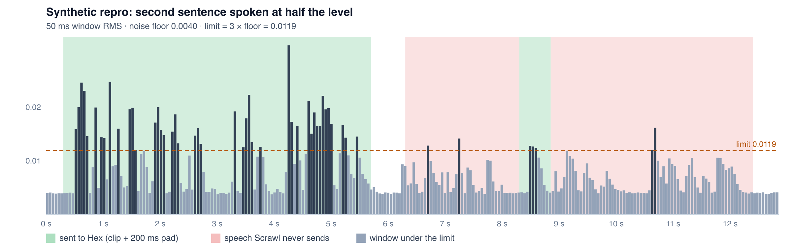
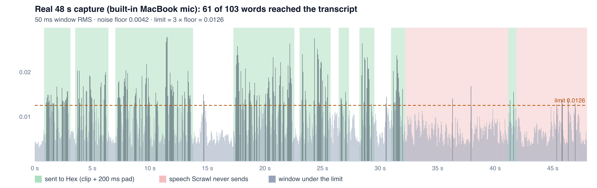

# Proof: Hex transcriber drops quiet speech

Proof for [kitlangton/scrawl#89](https://github.com/kitlangton/scrawl/issues/89). The `out-*` files and the PNG charts came from the shipped Scrawl 0.3.13 binary (`/Applications/Scrawl.app/Contents/MacOS/scrawl`) with Hex 2.3.1 and `parakeet_unified_en`, on 2026-10-22.

## Same audio, three ways

| Path | Output | Text |
|---|---|---|
| `scrawl reprocess --transcriber hex` | [`out-hex/`](out-hex/) | When I pick a different template and replace the dates, the feed lists every single milestone change. **And this** |
| `scrawl reprocess --transcriber apple` | [`out-apple/`](out-apple/) | When I pick a different template and replace the dates, the feed lists every single milestone change. It should say that the templates switch, and this which milestones change, rather than each one on its own line. |
| The whole `audio.wav` in one `POST /transcriptions` to Hex | [`out-hex-whole-file/`](out-hex-whole-file/) | When I pick a different template and replace the dates, the feed lists every single milestone change. It should say that the template switched and lists which milestones changed, rather than each one on its own line. |

The input is [`input.scrawl/`](input.scrawl/): a 12.9 s `audio.wav` made with macOS `say`, a blank `recording.mp4`, and a manifest with no events. The first sentence is at a normal level. The second sentence is at half that level, over a 0.004 RMS noise floor.

Hex can hear the quiet sentence: the whole-file request returns it. Scrawl's Hex path never sends it.

## Charts



The bars are the 50 ms window RMS that `audio::speech_islands` measures. The dashed line is its limit, `(floor * 3.0).clamp(0.005, 0.02)`. Green is what `hex::plan_clips` sends to Hex (with `CLIP_PAD_MS`). Red is speech that is never sent. The 100 ms window over the limit at 10.65 s is dropped by `MIN_ISLAND_MS`.



This is a real 48 s capture from a built-in MacBook mic. Its audio is private and not in this folder. Through Scrawl its transcript had 61 words. The same `audio.wav` sent whole to Hex gave 103 words. The red spans are the parts I sent to Hex alone, and each one came back with the missing words.

## Run it again

```sh
mkdir /tmp/scrawl-repro && cd /tmp/scrawl-repro
curl -sLO https://raw.githubusercontent.com/bath/scrawl/hex-quiet-speech-proof/hex-quiet-speech/repro.sh
chmod +x repro.sh && ./repro.sh        # SCRAWL=..., MODEL=... to override
```

It needs Hex running with a model ready, plus `say`, python3, ffmpeg and curl, and it takes about 5 s. To skip making the audio, run `scrawl reprocess input.scrawl --transcriber hex --out /tmp/out.scrawl` on the bundle in this folder. `chart.py` draws the charts.
