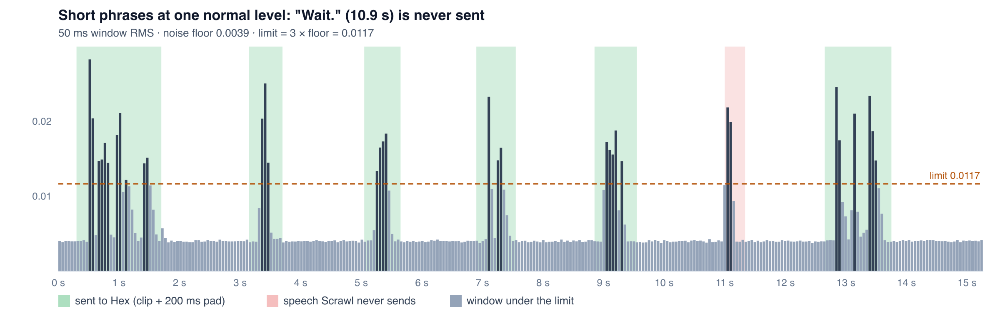

# Proof: Hex transcriber drops short words spoken on their own

Proof for the sibling issue of [kitlangton/scrawl#89](https://github.com/kitlangton/scrawl/issues/89). The `out-*` files and the chart came from the shipped Scrawl 0.3.13 binary with Hex 2.3.1 and `parakeet_unified_en`, on 2026-10-22.

## Same audio, three ways

[`input.scrawl/audio.wav`](input.scrawl/audio.wav) holds seven phrases made with macOS `say` ([`phrases/`](phrases/)), all scaled to one normal level (0.012 RMS), 1.5 s apart, over a 0.004 RMS noise floor (seed 2).

| Path | Output | Text |
|---|---|---|
| `scrawl reprocess --transcriber hex` | [`out-hex/`](out-hex/) | Open the Settings page. Yes. No. Okay. Delete it. Then click Save. |
| `scrawl reprocess --transcriber apple` | [`out-apple/`](out-apple/) | Open the settings page. Yes. No. Okay. Delete it. **Wait.** Then click save. |
| The whole `audio.wav` in one `POST /transcriptions` to Hex | [`out-hex-whole-file/`](out-hex-whole-file/) | Open the settings page. Yes. No. Okay. Delete it. **Wait.** Then click save. |

I ran the Hex path three times on this file, and it dropped "Wait." in all three runs.



"Wait." peaks at 0.022, as loud as the other words. But only two 50 ms windows are over the limit, so its island is 100 ms. `plan_clips` drops every island shorter than `MIN_ISLAND_MS` (120 ms), so the word is never sent. The window just before those two is at 0.0114, just under the limit of 0.0117.

## How often

Noise decides whether that third window crosses the limit, so the result depends on chance. [`rate.py`](rate.py) runs `speech_islands` and `plan_clips` (copied into Python) over the same seven phrases with 200 different noise draws:

```text
Open the settings page.    dropped in   0 / 200 noise draws
Yes.                       dropped in   0 / 200 noise draws
No.                        dropped in   0 / 200 noise draws
Okay.                      dropped in   0 / 200 noise draws
Delete it.                 dropped in   0 / 200 noise draws
Wait.                      dropped in 122 / 200 noise draws
Then click save.           dropped in   0 / 200 noise draws
```

## Run it again

```sh
git clone --depth 1 -b hex-quiet-speech-proof https://github.com/bath/scrawl.git scrawl-proof
scrawl-proof/hex-short-words/repro.sh                       # SCRAWL=... and MODEL=... to override
cd scrawl-proof/hex-short-words && uv run --with numpy python rate.py
```
